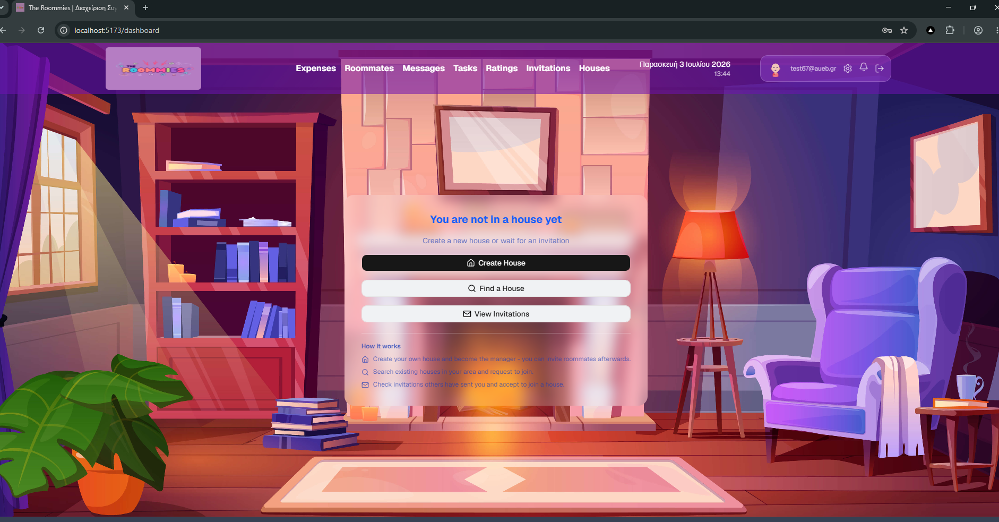
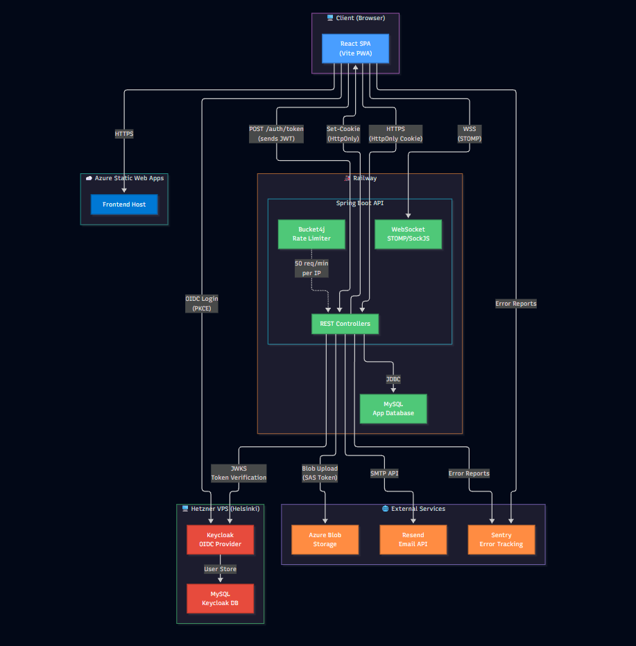
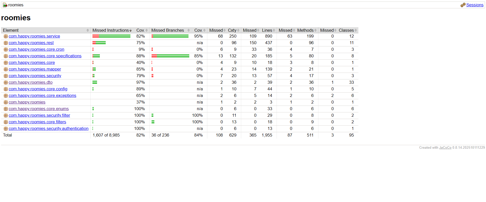
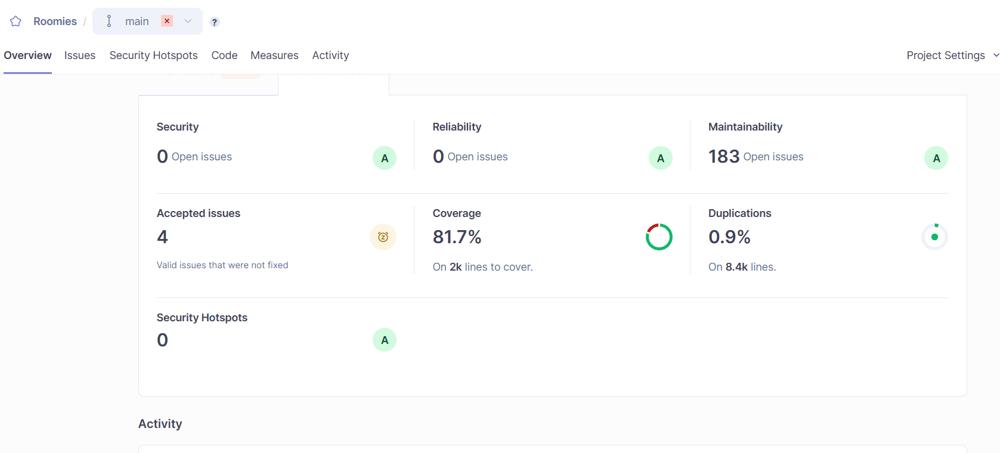
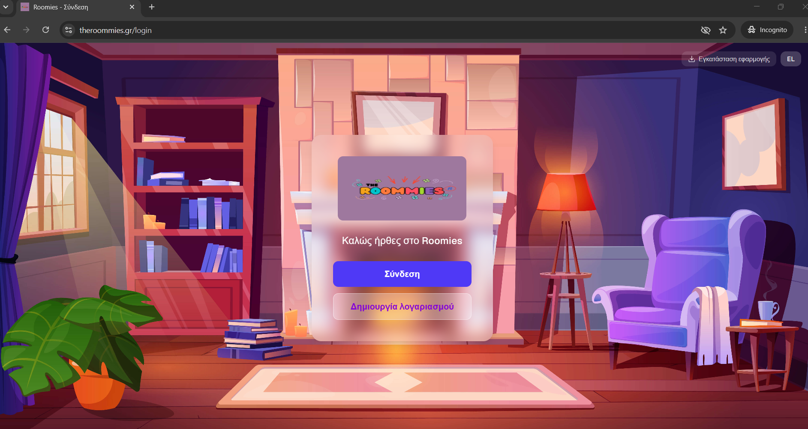
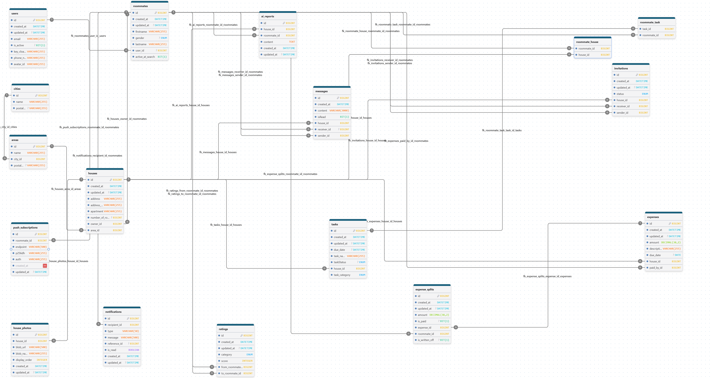

# 🏠 The Roommies | Backend Architecture & Technical Decisions

A production-grade **co-living management platform**, real-time messaging, expense splitting, task management, ratings, and AI-powered house reports. Built solo as a full-stack project, deployed and serving real users.

**🌐 Live:** [www.theroommies.gr](https://www.theroommies.gr)  
**💻 Frontend repo (public):** [roomies-frontend-React](https://github.com/grgks/roomies-frontend-React)  
**🔒 Backend & Frontend code:** Private repositories

> This repository documents the backend architecture, security model, and technical decisions. The source code lives in private repos.



---

## 📋 Table of Contents

- [Tech Stack & Why](#-tech-stack--why)
- [Architecture](#-architecture)
- [Security](#-security)
- [Data Flow Diagram](#-data-flow-diagram)
- [Authentication Flow](#-authentication-flow)
- [Features](#-features)
- [Infrastructure](#-infrastructure)
- [Testing & Code Quality](#-testing--code-quality)
- [Technical Challenges & Solutions](#-technical-challenges--solutions)
- [API Overview](#-api-overview)
- [Future Improvements](#-future-improvements)

---

## 🛠️ Tech Stack & Why

| Layer | Technology | Why This Choice |
|-------|-----------|-----------------|
| **Language** | Java 21 | Industry standard for enterprise backends; strong typing, mature ecosystem, excellent Spring integration |
| **Framework** | Spring Boot 4 | Convention over configuration, production-ready defaults, massive community support |
| **Auth** | Keycloak 26 + Spring Security OAuth2 | Full-featured OIDC provider without vendor lock-in; self-hosted = full control over user data (GDPR); free vs Auth0/Okta pricing |
| **Database** | MySQL 8.0 | Reliable RDBMS with strong JPA/Hibernate support; Railway provides managed instances with zero config |
| **ORM** | Spring Data JPA / Hibernate 7 | Reduces boilerplate, Specification API enables dynamic filtering, `@Convert` powers transparent encryption |
| **Real-time** | WebSocket / STOMP (SockJS) | Bi-directional messaging without polling; STOMP provides topic/queue semantics for group and private channels |
| **Rate Limiting** | Bucket4j | Token-bucket algorithm at the application level; runs before JWT validation to protect auth infrastructure |
| **DB Migrations** | Flyway | Versioned, repeatable migrations (V1–V9); validates schema on startup in production |
| **AI Integration** | Google Gemini API | Cost-effective generative AI for house reports; raw HTTP RestClient avoids SDK dependency bloat |
| **Web Push** | VAPID JWT (jose4j) | Browser push notifications when app is closed; no Firebase dependency |
| **Error Tracking** | Sentry | Real-time error monitoring with stack traces; Spring Boot + React integration |
| **Build** | Gradle | Faster builds than Maven, Kotlin DSL for type-safe configuration |
| **Containerization** | Docker & Docker Compose | Consistent dev/prod environments; Keycloak + MySQL stack in one command |

---

## 🏛️ Architecture

The backend follows a **layered architecture** with strict separation of concerns:

```
Controller → Service → Repository → Database
```

### Key Architectural Decisions

**Lazy User Sync** - The backend creates a `User` record on the first authenticated request, not at registration. Keycloak is the single source of truth for identity. This avoids two-phase registration flows and keeps the systems loosely coupled.

**Separate Admin / User Services** - Mass assignment protection via dedicated DTOs and services per role (`UserAdminService`, `GeneralAdminService`, `StaticDataAdminService`). A regular user endpoint can never accidentally expose admin-only fields.

**Specification-based Filtering** - All list endpoints support dynamic filtering via JPA Specifications with pagination. 8 Specification classes handle complex roommate/house matching with type-safe predicates.

**Profile / Preferences Pattern** - Search uses a 4-table design: `RoommateProfile` and `HouseProfile` store facts ("what you are"), `RoommatePreferences` and `HousePreferences` store filters ("what you want"). All use 1:1 FK with cascade delete and upsert-only semantics.

**Persisted Notifications** - `NotificationService` writes to the database first, then attempts real-time delivery via `@Async` STOMP push. Guarantees no notifications are lost. Offline users receive them on next login via REST.

**AI Report Anonymization** - Before calling the Gemini API, roommate names are replaced with placeholders (Roommate A/B/C) and a `Map<Placeholder, RealName>` is kept server-side. The AI response is post-processed to substitute real names back. User identities never leave the backend.

**Auto Expense Splitting** - When an expense is created, `ExpenseSplit` records are automatically generated for each house member. Equal splitting by default, with paid/unpaid tracking per roommate.

**Flush + Refresh Pattern** - All update methods force a DB flush and entity reload to return accurate `updatedAt` timestamps, avoiding stale JPA cache values in the response.

---

## 🔒 Security

Security is treated as a **first-class architectural concern**, not an afterthought.

### Authentication: BFF (Backend-for-Frontend) Pattern

The frontend never stores tokens. The full flow:

1. User authenticates with Keycloak via **Authorization Code Flow + PKCE**
2. Frontend receives authorization code, sends it to the backend
3. Backend exchanges code with Keycloak, sets **httpOnly, SameSite=Strict cookies**
4. All subsequent requests use cookies automatically (`withCredentials: true`)
5. `CookieBearerTokenResolver` reads JWT from the cookie not from the `Authorization` header

**Why this over Bearer tokens?** httpOnly cookies cannot be read by JavaScript, eliminating the most common XSS token-theft vector. Combined with SameSite=Strict, this also mitigates CSRF without requiring anti-CSRF tokens.

### Defense in Depth

| Layer | Mechanism | Details |
|-------|-----------|---------|
| **Rate Limiting** | Bucket4j filter | Runs *before* JWT validation; 1000 req/min per IP (production) |
| **CSRF Protection** | `CsrfHeaderFilter` | Requires `X-Requested-With: XMLHttpRequest` on state-changing requests |
| **RBAC** | JWT claims + `@PreAuthorize` | Roles (`ROOMMATE`, `LIGHT_ADMIN`, `SUPER_ADMIN`) checked at both config and method level |
| **Active User Check** | `ActiveUserFilter` | Runs after JWT validation; blocks soft-deleted users with valid but stale tokens |
| **Brute Force** | Keycloak built-in | 5 failed attempts → temporary lockout (1-15 min) |
| **Message Encryption** | AES/GCM via JPA `@Convert` | Chat content encrypted at rest; transparent encrypt/decrypt in the JPA layer |
| **Secure Logging** | Warn/debug pattern | Generic warnings in production, identifiers in debug only. No PII in logs |
| **Security Headers** | Spring Security + Caddy | HSTS, CSP (`script-src 'self'`), X-Content-Type-Options, X-Frame-Options |
| **SSH Hardening** | fail2ban + key-only auth | 5 attempts / 10 min ban on VPS; root login disabled |

### GDPR Considerations

- Messages encrypted at rest (AES/GCM)
- AI data anonymized before leaving the backend
- No PII in production logs
- EU data residency (Amsterdam + Helsinki)
- Cookieless frontend telemetry (Azure Application Insights)
- Soft delete preserves audit trail; hard delete removes from both DB and Keycloak

### STRIDE Threat Model

A full STRIDE threat analysis covering 6 domains and 24 threats is maintained in the backend repository:
- 0 Critical / 0 High residual risk
- 4 Medium / 20 Low residual risk
- [View Data Flow Diagram](docs/threat-model.png)

---

## 📊 Data Flow Diagram



**Trust Boundaries:**

| # | Boundary | Protocol |
|---|----------|----------|
| 1 | Client ↔ Server | HTTPS / WSS (TLS) |
| 2 | Server ↔ External Services | HTTPS (API keys, outbound only) |
| 3 | API ↔ Database | JDBC (Railway private network) |
| 4 | Keycloak VPS | Internet-exposed SSH + HTTPS |

---

## 🔐 Authentication Flow

```
┌──────────┐     ┌───────────┐     ┌──────────────┐     ┌──────────┐
│  Browser  │     │  Frontend │     │   Backend    │     │ Keycloak │
│  (React)  │     │  (Azure)  │     │  (Railway)   │     │(Hetzner) │
└─────┬─────┘     └─────┬─────┘     └──────┬───────┘     └────┬─────┘
      │                 │                   │                  │
      │  1. Click Login │                   │                  │
      │────────────────>│                   │                  │
      │                 │                   │                  │
      │  2. Redirect to Keycloak (PKCE)     │                  │
      │────────────────────────────────────────────────────────>│
      │                 │                   │                  │
      │  3. User authenticates              │                  │
      │<───────────────────────────────────────────────────────│
      │  (authorization code)               │                  │
      │                 │                   │                  │
      │  4. POST /auth/token (code)         │                  │
      │────────────────────────────────────>│                  │
      │                 │                   │                  │
      │                 │                   │  5. Exchange code │
      │                 │                   │─────────────────>│
      │                 │                   │  (tokens back)   │
      │                 │                   │<─────────────────│
      │                 │                   │                  │
      │  6. Set-Cookie: access_token (httpOnly, SameSite=Strict)
      │<────────────────────────────────────│                  │
      │                 │                   │                  │
      │  7. All subsequent requests carry cookies automatically │
      │────────────────────────────────────>│                  │
      │                 │                   │                  │
      │                 │                   │  8. JWKS verify  │
      │                 │                   │─────────────────>│
      │                 │                   │<─────────────────│
```

---

## ✨ Features

### Core
- **Expense management** - split shared costs, track who owes whom, mark as paid
- **Task management** - assign, filter by status, due dates, overdue tracking
- **Ratings** - rate roommates per category (Tasks, Initiative, Cohabitation, Communication)
- **Real-time messaging** - encrypted group & private chat over WebSocket/STOMP
- **Invitations** - send/accept/reject house invitations, 30-day expiry

### Discovery
- **Roommate & House Search** - find compatible matches using profile-based filtering (smoking, pets, noise level, rent, furnished, etc.)
- **Preferences as defaults** - saved preferences auto-fill search filters

### Notifications (Three-tier delivery)
1. **WebSocket/STOMP** - real-time for online users (private + group channels)
2. **REST API** - persistent storage for offline catch-up (All/Unread tabs, mark-as-read)
3. **Web Push (VAPID)** - browser notifications when app is closed

### AI
- **House report** - on-demand summary via Google Gemini, anonymized data, 24-hour cooldown cache

### Admin
- **Full admin panel** - paginated endpoints for all entities, user activate/deactivate/hard-delete, role-gated access

---

## 🏗️ Infrastructure

### Production Architecture

```
                    ┌─────────────────────────────┐
                    │   Azure Static Web Apps      │
                    │   React SPA (Frontend)       │
                    └──────────────┬───────────────┘
                                   │ HTTPS
                    ┌──────────────▼───────────────┐
                    │   Railway (EU, Amsterdam)     │
                    │   ┌───────────────────────┐   │
                    │   │  Spring Boot API      │   │
                    │   │  + Bucket4j            │   │
                    │   │  + WebSocket/STOMP     │   │
                    │   └───────────┬───────────┘   │
                    │               │ JDBC          │
                    │   ┌───────────▼───────────┐   │
                    │   │  MySQL (App DB)        │   │
                    │   └───────────────────────┘   │
                    └───────────────────────────────┘
                                   │ HTTPS (JWKS)
                    ┌──────────────▼───────────────┐
                    │   Hetzner VPS (Helsinki)      │
                    │   ┌─────────────────────┐     │
                    │   │  Caddy (reverse proxy│     │
                    │   │  + auto TLS)         │     │
                    │   └─────────┬───────────┘     │
                    │             │                  │
                    │   ┌─────────▼───────────┐     │
                    │   │  Keycloak 26         │     │
                    │   └─────────┬───────────┘     │
                    │             │                  │
                    │   ┌─────────▼───────────┐     │
                    │   │  MySQL (Keycloak DB) │     │
                    │   └─────────────────────┘     │
                    └───────────────────────────────┘

External: Azure Blob Storage, Sentry, Resend Email API
```

### Why Self-Hosted Keycloak?

| Factor | Managed (Auth0/Okta) | Self-Hosted (Keycloak) |
|--------|---------------------|----------------------|
| **Cost** | $23+/mo at scale | ~€4/mo (Hetzner CX23) |
| **Data control** | Vendor-managed | Full ownership (EU) |
| **Customization** | Limited | Complete (themes, flows, SPIs) |
| **Learning value** | Minimal | Linux, Docker, networking, TLS, security hardening |
| **Vendor lock-in** | High | None (standard OIDC) |

### VPS Security Hardening

- **SSH:** Key-only auth, root login disabled, fail2ban (5 attempts / 10 min ban)
- **Firewall:** UFW - only specific ports open
- **OS:** Ubuntu 24.04 LTS, unattended-upgrades with auto-reboot at 03:00 UTC
- **TLS:** Caddy auto-renewal (Let's Encrypt, 90-day rotation)
- **Docker:** Memory-limited containers, log rotation (30 MB max per service), private bridge network

### Monitoring

| Tool | What it monitors | Interval |
|------|-----------------|----------|
| UptimeRobot | Backend, Frontend, Keycloak health | Every 10 min |
| Sentry | Runtime errors (Spring Boot + React) | Real-time |
| Railway Healthcheck | `/health` endpoint | Every deploy + runtime |
| Azure App Insights | Frontend performance (cookieless) | Real-time |

### Automated Backups

| Database | Method | Schedule | Retention |
|----------|--------|----------|-----------|
| App MySQL (Railway) | GitHub Actions + mysqldump | Daily 04:30 UTC | 7 days |
| Keycloak MySQL (Hetzner) | cron + mysqldump on VPS | Daily 04:00 UTC | 7 days |

Both use `--single-transaction` for consistent snapshots without table locks.

### CI/CD

| Workflow | Trigger | Steps |
|----------|---------|-------|
| Backend CI | Push/PR to main | Build → Test (MySQL service container) → Docker build → Trivy security scan |
| DB Backup | Daily + manual | mysqldump → verify size → upload artifact |
| Railway | Push to main | Auto-deploy |
| Azure SWA | Push to main | Auto-deploy frontend |

---

## 🧪 Testing & Code Quality

| Metric | Result |
|--------|--------|
| **Instruction Coverage** | 82% |
| **Branch Coverage** | 84% |
| **Total Tests** | 900+ unit & integration |
| **Quality Gate** | ✅ Passed |
| **Security Rating** | A |
| **Maintainability** | A |
| **Duplications** | 0.9% |

**Test suite:**
- 13 Service tests (Mockito). Full business logic coverage
- 12 Controller tests (MockMvc standaloneSetup)
- Security tests ActiveUserFilter, RateLimitFilter, SecurityUtils
- Repository tests (`@DataJpaTest`). JPA queries against real MySQL
- 8 Specification tests (`@DataJpaTest`). All predicates with real data
- SecurityConfiguration test (`@SpringBootTest`). Full filter chain

**Static Analysis:** SonarQube Community. 0 vulnerabilities, CSRF hotspot reviewed and accepted.




---

## 🧩 Technical Challenges & Solutions

### 1. CSRF Protection with Cookie-Based Auth
**Problem:** Traditional CSRF tokens don't work well with SPAs. Using httpOnly cookies means the app is vulnerable to CSRF. Unlike Bearer tokens which are not automatically attached by browsers.

**Solution:** Custom `CsrfHeaderFilter` that requires `X-Requested-With: XMLHttpRequest` on all state-changing requests. Browsers don't attach custom headers on cross-site form submissions, blocking CSRF while keeping the cookie auth flow intact. Compatible with Spring Security 7.

### 2. Message Encryption Without Breaking JPA
**Problem:** Chat messages need encryption at rest, but encrypting at the application level breaks JPA queries and adds complexity to every read/write.

**Solution:** JPA `@Convert` with a custom `AttributeConverter` that handles AES/GCM encryption/decryption transparently. The entity field looks like a normal `String` to business logic, but the database stores only ciphertext. Added a standalone `KeyRotationTool` for re-encrypting all messages when rotating keys.

### 3. LazyInitializationException on House Ratings
**Problem:** Calculating average house rating requires loading roommates and their ratings. With pagination, `JOIN FETCH` causes the "HHH90003004: firstResult/maxResults specified with collection fetch" warning and breaks result counts.

**Solution:** Two-query strategy. First query gets paginated house IDs, second query uses `JOIN FETCH` with `WHERE id IN (...)` to load complete data without pagination conflicts.

### 4. AI Report GDPR Compliance
**Problem:** Sending house activity data to Google Gemini exposes roommate names to a third-party AI provider.

**Solution:** Pre-processing pipeline that replaces real names with placeholders (`Roommate A`, `Roommate B`) using a server-side mapping. The AI generates the report with placeholders, then a post-processor substitutes real names back. The mapping never leaves the backend.

### 5. Notification Reliability Across Connection States
**Problem:** WebSocket-only notifications are lost when users are offline. REST-only means constant polling.

**Solution:** Three-tier model. Persist to DB first (guaranteed delivery), then attempt STOMP push (`@Async`), plus VAPID Web Push for when the app is closed entirely. Offline users get notifications via REST on next login.

### 6. Soft-Deleted Users with Valid Tokens
**Problem:** When a user is deactivated, their JWT remains valid until expiry. They can still make API calls.

**Solution:** `ActiveUserFilter` runs after JWT validation on every request, checking `isActive` in the database. Excludes only the reactivation endpoint (`PUT /api/users/me/reactivate`) to allow self-service recovery.

---

## 📡 API Overview

| Controller | Base Path | Description |
|-----------|-----------|-------------|
| AuthRestController | `/api/auth` | Cookie-based auth: callback, token, refresh, logout |
| UserRestController | `/api/users` | Registration, profile, password |
| RoommateRestController | `/api/roommate` | Roommate profile management |
| HouseRestController | `/api/house` | House CRUD, search, leave |
| TaskRestController | `/api/task` | Task CRUD, assign, status |
| ExpenseRestController | `/api/expense` | Expenses and splits |
| InvitationRestController | `/api/invitations` | Send/accept/reject invitations |
| RatingRestController | `/api/rating` | Rate roommates, view averages |
| MessageRestController | `/api/messages` | Encrypted messaging (group + private) |
| NotificationRestController | `/api/notifications` | Notification history, mark as read |
| PushSubscriptionController | `/api/push` | Web Push subscription management |
| AiReportController | `/api/ai-report` | AI-powered house reports |
| AdminControllers | `/api/admin/*` | User management, entity overview |
| StaticDataController | `/api/static` | City/Area CRUD |
| HealthController | `/health` | Public health endpoint |

---

## 🔮 Future Improvements

- Redis backend for Bucket4j (multi-instance rate limiting)
- Export expenses as PDF
- Expense analytics/charts
- Recurring tasks
- Google Social Login
- Custom Keycloak theme
- Payment integration + Premium roles
- Google Play Store (TWA)

---

## 📸 Screenshots

### Application



### ER Diagram


---

## 📄 License

© 2026 Giorgos Kounelis. All rights reserved.

This repository documents the architecture and technical decisions of a private project. The source code is not included.

---

Built by [Giorgos Kounelis](https://github.com/grgks) · [LinkedIn](https://linkedin.com/in/giorgos-k-dev)
